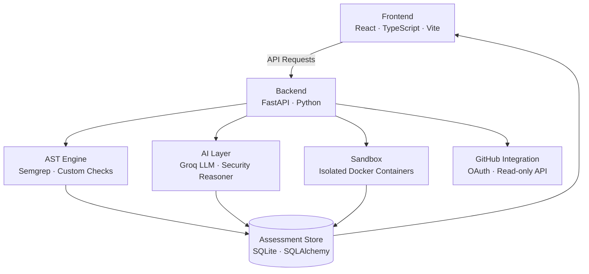

# ZORQEN

**Autonomous Security Validation for AI-built Software.**

ZORQEN continuously analyzes your repositories using static AST analysis, LLM-powered threat reasoning, and isolated sandbox verification — then delivers findings that are confirmed, prioritized, and explained. Not just flagged.

---

## Platform Preview

> *The ZORQEN investigation console — severity-ranked findings with AI reasoning, sandbox evidence, and one-click patch review.*

---

## What ZORQEN Does

### Static AST Analysis
Parses your repository at the syntax level. No runtime required. ZORQEN detects injection vectors, hardcoded secrets, authentication gaps, and misconfigured infrastructure before a single line of code executes.

### AI Threat Reasoning
Every candidate finding passes through an LLM investigation layer. ZORQEN explains the attack path, assesses exploitability in context, and eliminates false positives before they reach your team.

### Sandbox Verification
High-confidence findings are validated in isolated, disposable containers. ZORQEN doesn't just claim a SQL injection exists — it demonstrates the payload, captures the evidence, and then verifies the patch.

---

## Why ZORQEN

AI-assisted development has compressed the time from idea to deployment. Security review has not kept pace.

Traditional static analyzers were designed for human-written codebases. They generate findings in volume, offer minimal context, and produce noise at scale. Teams spend more time triaging alerts than resolving them.

ZORQEN is built for the current reality: repositories that move fast, contain AI-generated patterns, and need findings that are already investigated — not just reported.

- **Validation over volume.** Every finding is confirmed before it surfaces.
- **Context-aware reasoning.** The AI layer understands your codebase's architecture, not just its syntax.
- **Evidence by default.** Sandbox output, attack paths, and patch diffs are included in every critical finding.

---

## Core Workflow

```
Repository Connected
        ↓
   AST Analysis
        ↓
  AI Investigation
        ↓
 Sandbox Validation
        ↓
 Actionable Findings
```

---

## Platform Highlights

- **Repository intelligence** — framework detection, dependency mapping, architecture profiling
- **AI investigation console** — LLM reasoning on every finding, with attack path visualization
- **Severity prioritization** — critical, high, medium, low — scored by exploitability, not pattern count
- **Sandbox verification** — live payload testing in isolated Docker containers
- **Read-only GitHub integration** — OAuth-based, zero write permissions, no repository access beyond analysis
- **Security copilot** — conversational interface for querying findings and understanding vulnerabilities
- **Enterprise-ready UX** — monochrome interface, high-contrast typography, distraction-free investigation workflow

---

## Architecture



---

## Technology Stack

| Layer | Technology |
|---|---|
| Frontend | React 19, TypeScript, Vite |
| Styling | Tailwind CSS v4 |
| Deployment | Cloudflare Pages |
| Backend | Python, FastAPI, Uvicorn |
| AI Reasoning | Groq API (Llama 3) |
| Static Analysis | Semgrep, Custom AST Checks |
| Sandbox | Docker (isolated containers) |
| Database | SQLite via SQLAlchemy |
| Auth | GitHub OAuth 2.0 |

---

## Design Philosophy

ZORQEN uses a monochrome foundation with a lime accent — a deliberate choice for a security context where cognitive load matters. High-contrast typography keeps findings readable under pressure. Every interface decision prioritizes the investigation workflow over visual decoration.

The goal is an environment where a security engineer can move from repository overview to confirmed findings to patch review without friction or distraction.

---

## Vulnerability Coverage

| Category | Method | CWE |
|---|---|---|
| SQL Injection | Semgrep + Custom | CWE-89 |
| Command Injection | Semgrep + Custom | CWE-78 |
| Path Traversal | Custom | CWE-22 |
| Cross-Site Scripting | Semgrep | CWE-79 |
| Hardcoded Secrets | Secret Detector | CWE-798 |
| Missing Authentication | Custom | CWE-306 |
| IDOR | Custom | CWE-639 |
| CORS Misconfiguration | Custom | CWE-942 |
| Insecure Deserialization | Custom | CWE-502 |
| Weak Cryptography | Custom | CWE-338 |
| Docker Misconfiguration | Custom | CWE-250 |
| Vulnerable Dependencies | Custom | CWE-1035 |

---

---

## GitHub Permissions & Least Privilege

ZORQEN performs **read-only analysis** of connected codebases. It fetches repository metadata, trees, file blobs, and language statistics to generate vulnerability findings.

- **Workflow Model**: All write operations in the GitHub client (`create_branch`, `create_or_update_file`, `create_pull_request`) are strictly disabled and reject mutation requests.
- **Classic OAuth App**: GitHub's OAuth 2.0 system lacks a granular `repo:read` scope. Accessing private repositories under a classic OAuth App requires the standard `repo` scope, which GitHub provides as a read/write permission.
- **GitHub App (Recommended for Production)**: For strict least privilege, deploy ZORQEN as a GitHub App with granular permissions:
  - `Contents: Read-only`
  - `Metadata: Read-only`
  - `Email addresses: Read-only`

---

## Roadmap

- [x] Repository Intelligence
- [x] AI Investigation Console
- [x] Security Findings Dashboard
- [ ] Sandbox Verification Engine (Infrastructure Pending)
- [x] Security Copilot
- [x] Patch Diff Viewer
- [ ] Live Repository Sync
- [ ] Collaborative Investigations
- [ ] Enterprise Policy Engine
- [ ] CI/CD Pipeline Integration
- [ ] Multi-repository Portfolio View

---

## Contributing

We welcome thoughtful contributions that improve security validation, developer experience, and platform quality.

Open an issue to discuss significant changes before submitting a pull request. For smaller improvements, a focused PR with clear context is the fastest path to review.

---

## License

Licensed under the [Apache License 2.0](./LICENSE).

---

## Local Development

```bash
# Backend
cd backend
pip install -r requirements.txt
uvicorn main:app --host 0.0.0.0 --port 8000 --reload

# Frontend
cd frontend
npm install
npm run dev
```

Open `http://localhost:5173` and use **Demo Mode** to explore the platform without credentials.

For full GitHub integration, configure `GITHUB_CLIENT_ID`, `GITHUB_CLIENT_SECRET`, and `GROQ_API_KEY` in your `.env` file. See `.env.example` for reference.

---

*ZORQEN — Find it. Fix it. Prove it.*
